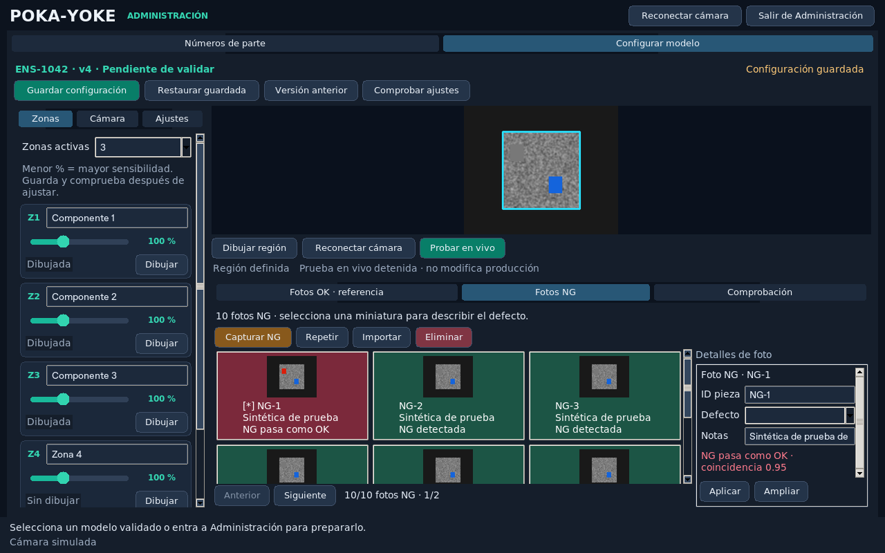
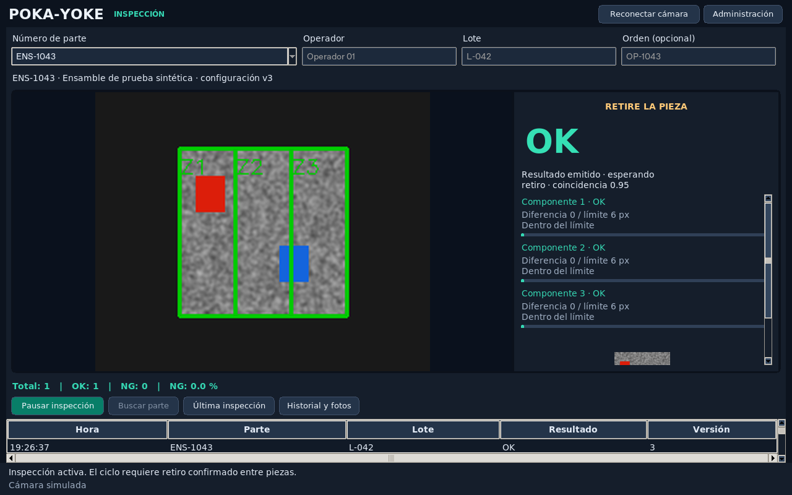
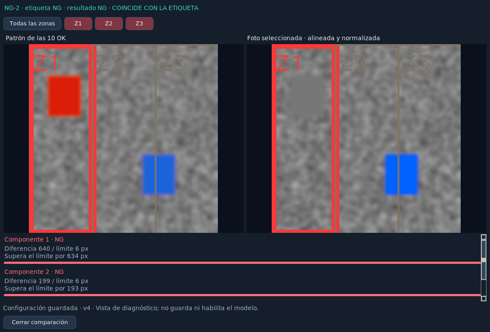
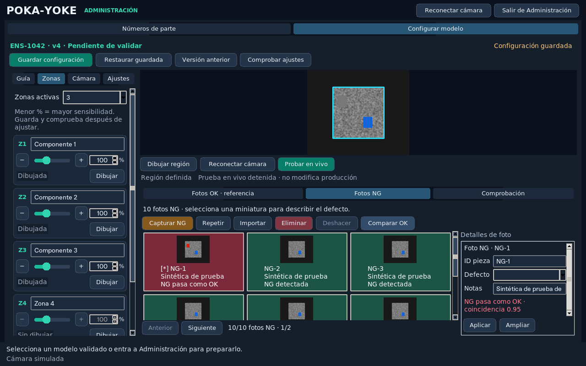
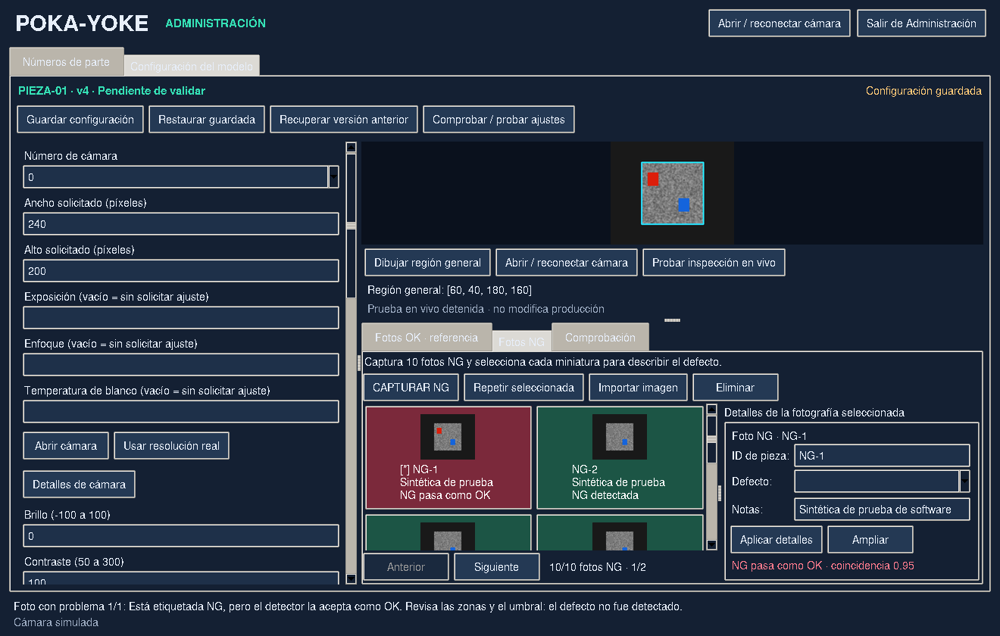

# Poka-Yoke 5

Versión **5.5.2**. Aplicación local de inspección visual para ensambles, con interfaz industrial oscura en **CustomTkinter** y modos de Administración e Inspección separados. El motor de comparación incorpora referencias completas independientes; consulta la sección siguiente. Todo el programa está en **poka_yoke_mejorado5.py**, sin módulos propios adicionales.

La tercera línea de `poka_yoke_mejorado5.py` identifica la versión y fecha de actualización. En cada nueva actualización del programa se incrementa esa versión y se mantienen sincronizados el título de la ventana y la versión de este README.

## Motor: referencia real y versiones completas

El patrón visible se elige como una fotografía OK real alineada y representativa de las diez (medoide); no se fusionan variantes mediante una media por píxel. Para aceptar una pieza, todas las zonas deben aprobar contra **la misma referencia completa**. La ventana Comparar OK muestra qué OK se utilizó realmente. La variación entre versiones no ensancha automáticamente los umbrales por píxel.

Si cambia la referencia o la decisión de una zona durante la acumulación temporal, se reinicia esa acumulación. Una alineación insuficiente produce sin evaluación. Las pantallas, cámara, usuarios y almacenamiento se conservan.

**Actualización:** conserva la carpeta `datos` y sustituye el Python. Las aprobaciones anteriores quedan pendientes por el cambio de motor; repite Comprobar 10 OK + 10 NG y Habilitar inspección. No necesitas recapturar imágenes utilizables. Revisa de nuevo sensibilidad y defectos mínimos detectables con piezas físicas. El software no recupera detalles ausentes en fotografías borrosas.

El motor **complete-reference-engine-2** corrige la alineación con cada referencia nativa y calibra pequeñas variaciones entre capturas OK completas, con un límite de calibración del 1% de área por zona antes de aplicar los factores existentes. Las NG no entrenan el patrón. [Corrección de calibración y límites](docs/calibracion_motor_2.md).

Validación de esta corrección: 10 regresiones nuevas y 26 pruebas originales enfocadas aprobadas; no se declara nuevamente aprobada la suite gráfica completa. Las mediciones de rendimiento publicadas para el motor anterior no caracterizan esta nueva comparación con múltiples referencias. [Detalles del motor y límites](docs/motor_referencias_completas.md).

## Ejecutar

Recomendado: Python 3.12 de 64 bits, con Tkinter. Desde esta carpeta:

```sh
python -m pip install -r requirements.txt
python poka_yoke_mejorado5.py
```

En Windows puedes usar `py -3` en lugar de `python`. Para actualizar, cierra el programa y reemplaza únicamente el archivo `.py`, conservando tu carpeta `datos`. Si vienes de una versión anterior, instala una vez la nueva dependencia con `python -m pip install "customtkinter>=5.2.2,<6"`. Si sólo descargas el `.py`, puedes instalar todas las dependencias con `python -m pip install numpy opencv-python Pillow customtkinter`.

## Interfaz industrial y distribución compacta

La ventana admite tamaños desde **1000 × 680**. Las acciones usan botones de 30 píxeles de alto antes del escalado de pantalla; las barras los distribuyen en varias filas cuando falta ancho, en lugar de recortarlos. Verde identifica acciones principales, ámbar la captura NG y rojo la eliminación. Cada botón también conserva su texto.

En **Configurar modelo**, el panel lateral incluye **Guía** para seguir la preparación y tres pestañas de controles: **Zonas** reúne los nombres, sliders de 1–300 % y botones de dibujo; **Cámara** agrupa el dispositivo, resolución y propiedades; **Ajustes** contiene brillo, contraste, tolerancia base, normalización de color y retiro de pieza. Cada panel tiene desplazamiento vertical.

La cámara permanece visible sobre las pestañas OK, NG y Comprobación. Las miniaturas se distribuyen en **2, 3 o 4 columnas** según el ancho disponible. Los detalles de la foto están a la derecha; **Aplicar** y **Ampliar** permanecen fijos mientras los detalles largos se desplazan. Las acciones para comprobar y habilitar una versión están al principio de Comprobación.

[Ver la distribución a 1000 × 680](docs/interfaz_industrial_1000x680.png).





Capturas de la aplicación con cámara e imágenes sintéticas. El rediseño conserva modelos, fotos, configuraciones, contraseña, historial y criterios de evaluación de la versión anterior.

## Fluidez de cámara e inspección

La versión 5.5.1 elimina la reconfiguración del panel administrativo después de cada cuadro de producción. Revisa tareas y cuadros nuevos cada 15 ms; la vista de cámara se dibuja hasta 20 veces por segundo y continúa actualizándose mientras se calcula o guarda una inspección. Los cuadros de cámara se copian cuando hay uno nuevo.

La vista previa se reduce al tamaño de pantalla antes de convertirla para Tk y reutiliza su elemento de imagen. **El motor sigue recibiendo el cuadro original a resolución completa**, con los mismos umbrales, seis cuadros de estabilización y ocho de promedio.

OK/NG puede mostrarse mientras se guardan las imágenes del evento. El mensaje **guardando registro** indica que el contador todavía está pendiente; se actualiza una sola vez al confirmar el registro. El cierre del programa conserva la comprobación de operaciones pendientes. El sonido NG se emite sin bloquear el hilo del motor.

En una prueba sintética con cámara simulada de 30 FPS, la mediana hasta ver el resultado pasó de **1,38 s a 0,48 s**. El dibujo de una vista previa FHD pasó de **22,8 ms a 3,0 ms** en el entorno de prueba. Son mediciones de nube, no de una cámara física ni de la computadora del usuario. [Método y resultados](docs/rendimiento_5_5_1.md).

## Preparación guiada y diagnóstico

En **Guía** se muestra el avance de seis pasos para el número de parte abierto: cámara conectada y compatible, región, zonas activas, diez fotos OK, diez NG y comprobación. **Ir** lleva a cada sección; **Siguiente paso** abre el primer pendiente. Los pasos de fotos cuentan archivos disponibles; la comprobación confirma si pueden evaluarse y si sus resultados coinciden con las etiquetas.

La guía se actualiza al capturar, editar o comprobar. Los cambios sin guardar dejan la comprobación pendiente. Completar la lista no habilita automáticamente la producción: utiliza **Habilitar inspección** en Comprobación después de guardar y obtener resultados correctos.

## Comparar una foto con las OK

Selecciona una miniatura y pulsa **Comparar OK**. La ventana muestra la referencia completa seleccionada entre las mismas diez OK y la región evaluada de la foto seleccionada, alineada y normalizada como la ve el motor. La cabecera distingue la etiqueta indicada por el administrador del resultado calculado: una foto NG aceptada aparece como **NG PASA COMO OK**.

Las zonas tienen contornos verdes o rojos. Se resalta primero la zona que falla; **Todas las zonas** y **Z1**, **Z2**, etc. permiten cambiar el resaltado. Las mediciones y barras muestran el área de diferencia, su límite y cuánto lo supera. Si no hay coincidencia suficiente, se conserva la foto completa y se indica **SIN EVALUACIÓN**. Si faltan referencias utilizables, se puede ver una OK disponible sin inventar un resultado.

La comparación usa una copia de los ajustes actuales. Indica si corresponde al borrador o a una versión guardada. No guarda nuevas referencias, no habilita el modelo y no añade inspecciones ni contadores de producción.



[Ver el ejemplo de una NG que pasa como OK](docs/comparacion_ng_pasa_ok.png).

## Ajuste numérico y deshacer fotos

Cada slider de zona tiene un campo numérico de **1 a 300 %** y botones **− / +** para cambiar de uno en uno. Campo y slider permanecen sincronizados; los valores fuera del rango se marcan y deben corregirse antes de guardar. Los controles de las zonas 4 y 5 se desactivan con el modo de tres zonas.



**Deshacer**, disponible en ambas galerías, revierte hasta los últimos veinte movimientos de fotos del borrador: captura, importación, reemplazo o eliminación. Una acción cancelada o fallida no ocupa el lugar de la última acción válida. Al recuperar una foto se conservan sus detalles anteriores; se mantienen los ajustes y las ediciones posteriores de otras fotos.

Este historial es temporal: se limpia al guardar, cargar o restaurar un modelo, cambiar de número de parte, región o resolución. No borra archivos del historial guardado. Después de deshacer debes guardar para conservar el resultado.

## Estados de producción

El número de parte permanece en la cabecera de operación, con un resultado OK/NG grande. La fase se muestra por separado: **ESPERANDO PIEZA**, **MANTENGA LA PIEZA FIJA**, **EVALUANDO**, **RETIRE LA PIEZA**, **PAUSADA** o **SIN CÁMARA**. El resultado emitido se conserva durante la espera de retiro; no se crea otra inspección por mostrarlo.

Las zonas muestran barras y mensajes como **Diferencia 48 / límite 30 px**, con la explicación de si exceden el límite. El área corresponde al mayor defecto conectado que calcula el motor; las barras no cambian los umbrales. Las mediciones y la referencia tienen desplazamiento para mantener los controles principales accesibles con cinco zonas.

## Seleccionar una cámara USB o integrada

Entra a **Administración**. En la barra **Cámara de esta PC**, disponible incluso sin abrir un modelo:

1. Pulsa **Buscar cámaras USB / PC**. Se prueban los números 0–10 y el configurado actualmente; solo se listan dispositivos que entregan imagen, con su número y resolución real. La vista previa se interrumpe durante la búsqueda y después se intenta restablecer la cámara anterior. La búsqueda puede tardar según el controlador.
2. Elige un resultado y pulsa **Conectar seleccionada**. También puedes escribir manualmente un número de 0 a 20 si el dispositivo está fuera de la búsqueda o estaba ocupado.
3. Con un modelo abierto, pulsa **Guardar configuración** para conservar la cámara elegida para ese número de parte. Sin modelo, la elección se utiliza solo en la vista previa.

El selector numérico original sigue en **Configurar modelo → Cámara**. Verifica la imagen después de cambiar de dispositivo; los índices de Windows pueden cambiar al reconectar cámaras. Si la lista queda vacía, cierra otras aplicaciones que usen la cámara y revisa la conexión y permisos de Windows. La detección usa OpenCV y no requiere dependencias nuevas. Cada cámara se identifica por número y resolución, sin asumir el nombre comercial del dispositivo.

La búsqueda y el cambio de dispositivo pausan las pruebas en vivo y la inspección. No modifican las referencias ni la resolución configurada. Una cámara que entregue otra resolución requiere revisar la receta y su calibración antes de inspeccionar. Cinco nuevas pruebas de descubrimiento y selector, incluidas pruebas de interfaz y persistencia, y las ocho pruebas anteriores de cámara pasaron con dispositivos simulados en Windows; no se ha validado aquí la nueva cámara USB física del usuario.

## Cámara

La cámara se abre automáticamente al iniciar, aunque no haya un modelo registrado. El botón **Reconectar cámara** está visible en la parte superior. La vista previa no inicia la inspección ni incrementa contadores.

En Administración puedes seleccionar otro número de cámara y su resolución. Al cargar un modelo se abre su cámara automáticamente. El estado inferior informa la resolución real y los errores; en Windows se intentan otros controladores si el primero abre el dispositivo pero no entrega imágenes.

## Preparar un número de parte con sólo 10 OK y 10 NG

1. Entra a Administración y establece tu contraseña local en el primer uso.
2. Crea un número de parte, o copia tus modelos anteriores con **Importar v3/v4** sin modificar los originales.
3. Configura la cámara y dibuja la región general de la pieza.
4. En **Fotos OK · referencia**, pulsa **CAPTURAR OK** hasta completar diez fotos conformes. **Estas mismas diez fotos son la referencia del modelo. No se solicita un segundo grupo de OK.**
5. Dibuja tres o cinco zonas y asigna sus nombres.
6. En **Fotos NG**, pulsa **CAPTURAR NG** hasta completar diez fotos defectuosas. Las NG nunca se incorporan al patrón OK.
7. Ajusta los deslizadores de umbral por zona y guarda la configuración.
8. En **Comprobación**, pulsa **Comprobar 10 OK + 10 NG**. Se utilizan las diez OK ya guardadas y las diez NG: no necesitas más capturas.
9. Revisa el resultado y habilita esa versión si las veinte fotos se evaluaron correctamente. Después sal de Administración, selecciona el número de parte e introduce operador y lote para inspeccionar.

Una vez completas las diez fotos de cada clase, utiliza **Repetir** para sustituir una. No se agregan fotos adicionales desde los botones de captura. Si un modelo anterior tiene muestras adicionales, se conservan; la comprobación utiliza las diez posiciones OK de referencia y las primeras diez NG. Las muestras OK adicionales de versiones anteriores ya no se piden ni se usan para este requisito.

## Umbral por zona con deslizadores

Cada zona tiene un deslizador y su valor visible. El rango es de **1 % a 300 % de la calibración automática**; conserva el significado de los límites de versiones anteriores. Un porcentaje menor aumenta la sensibilidad; uno mayor permite diferencias mayores. El límite calculado conserva un mínimo de 6 píxeles de área del defecto; el deslizador no cambia los umbrales de diferencia de color por píxel. Las zonas 4 y 5 quedan desactivadas cuando seleccionas el modo de tres zonas.

Los ajustes son temporales hasta pulsar **Guardar configuración**. Al volver a seleccionar ese número de parte se recuperan sus valores, sin mezclarlos con los de otro modelo. **Restaurar guardada** descarta el borrador; **Versión anterior** recupera ajustes e imágenes anteriores como otra versión pendiente de comprobar.

## Miniaturas y detalles de cada foto

La cámara permanece visible encima de las galerías. Las miniaturas aparecen a la izquierda y los detalles de la foto seleccionada a la derecha.

Al capturar, la foto queda seleccionada y puedes editar **ID de pieza**, **tipo de defecto o característica** y **notas**, sin preguntas emergentes para clasificarla. La sección determina OK o NG. Puedes elegir un tipo sugerido o escribir uno propio; esa etiqueta es una anotación del administrador, no un diagnóstico automático del motor.

Usa el mismo ID si varias fotos corresponden a la misma pieza física. **Aplicar** prepara los cambios en el borrador; **Guardar configuración** los conserva en ese número de parte. La comprobación cuenta fotografías: diez vistas de una misma pieza no demuestran el comportamiento con diez piezas diferentes.

**Repetir** conserva los detalles al cambiar su imagen. **Ampliar** abre la fotografía grande. También puedes importar imágenes compatibles, eliminar capturas y exportar/importar modelos completos con sus detalles.

## Cómo interpretar la comprobación

Las diez OK forman el banco de referencias completas y después se comprueban contra ese mismo banco. Su resultado se muestra como **comprobación de referencia OK**, separado del resultado de las NG. **No es una validación independiente ni mide el desempeño con piezas nuevas.**

Para habilitar una versión se requieren diez OK comprobadas y diez NG comprobadas, sin rechazos de las OK, aceptaciones de las NG ni fotografías sin evaluación. Una NG que no se puede localizar queda sin evaluación; no cuenta como defecto detectado. La aprobación y los resultados pertenecen a la versión exacta guardada.

En el historial se distinguen las comprobaciones de referencia, las pruebas NG y la producción. Los contadores de operación incluyen únicamente inspecciones de producción del número de parte y lote activos.

## Fotos con errores visibles

Guarda los ajustes y pulsa **Comprobar 10 OK + 10 NG**. Cada miniatura y fila de la comprobación muestra su resultado:

- **Verde:** coincide con la etiqueta. Una NG correctamente detectada también se marca en verde.
- **Rojo:** error, por ejemplo **NG pasa como OK**, **OK pasa como NG**, foto ilegible o una imagen que **no cuenta como NG** por ser idéntica a una OK o repetir otra NG.
- **Ámbar:** fotografía sin evaluación, por ejemplo porque no se localiza la pieza. Se informa el motivo; no se cuenta como defecto detectado.
- **Sin comprobar:** no hay un resultado de esa configuración.

Al terminar se abre la primera foto con problemas. **Siguiente error**, en Comprobación, permite recorrer las demás. Selecciona una miniatura y pulsa **Ampliar** para ver su imagen, etiqueta esperada, resultado, coincidencia, mediciones por zona y explicación del error. Las referencias OK que no se alinean quedan identificadas por su posición.

La comprobación continúa con las demás fotos si una imagen está dañada o tiene dimensiones incorrectas. Cuando un error en las referencias impide construir el patrón, las fotos afectadas se señalan y las demás quedan sin evaluar con la explicación correspondiente.

Los resultados se conservan en el historial local y se recuperan al abrir el mismo modelo y versión. Después de cambiar un ajuste se marcan como anteriores; guarda y repite la comprobación para obtener resultados actuales. Las fotos nuevas no heredan el resultado de las que reemplazaron.



Ejemplo generado con imágenes sintéticas para comprobar la interfaz.

## Probar inspección en vivo antes de habilitar producción

En Administración, junto a la cámara, pulsa **Probar en vivo**. Necesitas diez OK utilizables, las zonas configuradas y una imagen compatible de cámara. **Las pruebas NG fallidas, incompletas o sus archivos dañados no bloquean esta prueba administrativa.** Si una referencia OK no permite construir el patrón, debe corregirse antes.

La pantalla muestra **PRUEBA**, el resultado y las zonas. El ciclo evalúa una vez y espera retiro de la pieza; puedes detener y volver a iniciar para repetir una prueba. No habilita el modelo, no incrementa contadores de producción ni guarda automáticamente inspecciones de producción.

Si cambias un ajuste, la prueba se detiene para que la reinicies con los valores actuales. También se detiene si se pierde la cámara. El botón permite detenerla manualmente. La inspección de producción conserva sus requisitos de comprobación, integridad de datos y habilitación.

## Datos y respaldos

Por defecto se guardan modelos, versiones, contraseña y registros en `datos`, junto al archivo Python. La ubicación no depende de la carpeta desde la que se ejecuta. Puedes cambiarla:

```sh
python poka_yoke_mejorado5.py --data-dir "D:/PokaYokeDatos"
```

La carpeta de datos está excluida de Git. Para respaldar todo, cierra el programa y copia esa carpeta. Exportar un modelo conserva su receta actual e imágenes, pero no incluye la contraseña ni el historial completo. Las configuraciones anteriores siguen siendo compatibles.

## Verificación y límites

La versión anterior del motor reportó **102 pruebas automatizadas**. Ese resultado no se atribuye a este motor v2, verificado con las 36 pruebas enfocadas indicadas arriba. La suite original incluye incluidas pruebas de interfaz con cámara simulada, persistencia de deslizadores, diagnósticos por foto, comparación con el patrón OK, guía de preparación, controles numéricos, deshacer fotos sin perder otros ajustes, estados de producción, compatibilidad del historial anterior, pruebas en vivo sin habilitación y el flujo completo con las mismas diez OK de referencia y diez NG usando el motor OpenCV sobre imágenes sintéticas. También se verifican cámara y resultado durante un guardado lento, una sola inspección por pieza, vista previa durante un cálculo bloqueado y conservación de la resolución original. Las pruebas de distribución comprueban límites y acceso a botones a **1000 × 680, 1280 × 720 y 1440 × 900**, barras con varias filas y escalado de controles al 125 %. No se verificó una cámara física ni su controlador de Windows.

Comprueba en tu equipo enfoque, iluminación, resolución, velocidad y resultados con piezas reales. La presencia y el retiro se estiman visualmente; no hay un sensor físico de presencia. El motor indica diferencias por zona, sin diagnosticar automáticamente el tipo de defecto.

Para ejecutar las pruebas:

```sh
python -m unittest discover -v
```

Las pruebas de interfaz necesitan una sesión gráfica. Sin ella se marcan omitidas; no se consideran ejecutadas. Las pruebas usan cámaras simuladas y no activan tu cámara física.
